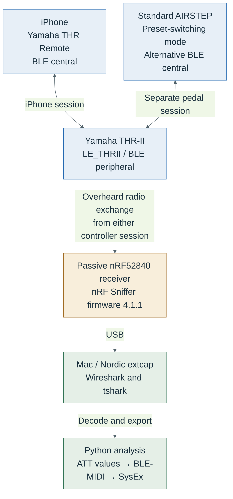

# THR-II BLE control, explained

**Start here:** [repository map and device workflows](docs/START-HERE.md) — what to flash onto the sniffer and ESP32, what to run on the Mac, where build outputs go, and which local files are required.

An investigation of how **Yamaha THR Remote on iPhone** and a **standard AIRSTEP pedal** control a Yamaha THR10II amplifier over Bluetooth Low Energy. A separate nRF52840 radio passively captured the exchanges; Wireshark and small scripts exposed the BLE-MIDI messages inside them.

The practical result: both controllers use the same stored-preset selection command for slots **1–5**, after accounting for BLE-MIDI timestamps and an observed message counter. A Swift/CoreBluetooth client subsequently selected all five slots from a Mac after the required initialization.

This repository also contains an ESP32-C3 OLED button controller built from that work.

## Photos and videos

[Photos and videos on iCloud](https://www.icloud.com/sharedalbum/#D1gv33qrpzfwJK_ixino80GCHXgCAEQARogMqE5r0nIYdVyxgs--WrxOad_LXaJh-A9I78Gj7i_raI)

## How the setup works



The iPhone and AIRSTEP were tested **in separate sessions**, with one controller connected at a time. The sniffer does not join the control connection, pair with the amplifier, relay commands or act as an intermediary. It listens to transmissions from both ends, follows the connection's radio parameters and forwards received packets to the Mac. Solid arrows show the participants' connection and the USB/analysis path; the dashed arrow shows passive radio reception.

This concerns **BLE-MIDI control**, not Bluetooth Classic audio streaming.

### From discovery to a readable command

| Stage | What the devices do | What the sniffer must capture |
| --- | --- | --- |
| Discover | The amplifier advertises `LE_THRII`; the controller finds it. | Advertising that identifies the target. Receiving advertisements alone does not prove connection following. |
| Follow | The controller initiates a BLE connection. | The connection request and parameters needed to follow hopping across data channels. |
| Pair and encrypt | The peers negotiate security and enable link encryption. | Complete pairing and encryption startup, or an already known bond key for a later connection. |
| Decode | The application initializes the amplifier, then sends a preset request and receives notifications. | Readable ATT values that can be unpacked into BLE-MIDI and SysEx, then compared across isolated actions. |

### Hardware used

| Component | Role |
| --- | --- |
| Yamaha THR10II | Amplifier and BLE peripheral, advertised as `LE_THRII`; firmware response `1.5.0.0.b`. |
| iPhone running Yamaha THR Remote | BLE central used to initialize the amplifier, select stored presets and change Gain. |
| Standard AIRSTEP, not YT Edition | Alternative BLE central; the user configured buttons A–E to select slots 1–5. |
| SuperMini/nice!nano-style nRF52840 board | Separate passive receiver running experimental Nordic sniffer firmware. |
| Apple M2 Mac | USB capture host and analysis workstation; also used for a separate CoreBluetooth replay test. |
| ESP32-C3 board with SSD1306 72×40 OLED | Subsequent button-controller prototype; not needed for passive capture. |

The sniffer firmware was experimentally installed on the specific nRF52840 board used here. This does not establish compatibility with every board sold as SuperMini. For another setup, use Nordic-supported hardware and the firmware appropriate to that board.

## Software used

Versions below describe this investigation, not minimum requirements or a claim about current releases.

| Tool | Version used | Purpose |
| --- | --- | --- |
| Yamaha THR Remote for iOS | App/iOS versions not recorded | Generated the iPhone control exchange. |
| Nordic nRF Sniffer firmware | 4.1.1 | Captured BLE radio packets on the nRF52840. |
| Nordic nRF Util | 8.2.1 | Installed and launched Nordic's sniffer tooling. |
| nRF Util `ble-sniffer` plugin | 0.21.0 | Provided BLE capture and Wireshark extcap integration. |
| nRF Util `device` plugin | 2.23.0 | Identified the connected USB board during setup. |
| Wireshark / tshark | 4.6.9 | Decoded pairing, encryption, GATT/ATT and BLE-MIDI; exported characteristic values. |
| Python | 3.9.6 | Ran the capture wrapper and analysis helpers. |
| Swift / Apple CoreBluetooth | Compiler version not recorded | Tested direct preset selection from the Mac after initialization. |
| macOS | 26.6.2, Apple Silicon | Capture and replay host. |

The AIRSTEP firmware version was not recorded. AIRSTEP was the alternative controller, not part of the capture software stack.

The later ESP32 prototype used **PlatformIO espressif32 6.12.0**, **Arduino-ESP32 2.0.17**, **NimBLE-Arduino 1.4.3**, and **esptool 4.12.0**. The initial display experiment used **U8g2 2.36.15**; the working display implementation uses direct Wire/I²C commands instead.

## Why the encrypted traffic was readable

The link was encrypted. In the observed sessions, both controllers negotiated **LE Legacy Pairing with Just Works** with the amplifier.

Under that method, the Temporary Key (TK) is the known value zero. Capturing both pairing random values allows the Short Term Key (STK) to be calculated; capturing encryption startup then provides the context needed to derive the session key and decrypt the exchange. This does not require brute-forcing AES. Bond information learned during pairing can support decryption of later connections if retained.

The iPhone advertised Secure Connections support in its request, but the amplifier's response did not support it. The negotiated result therefore remained Legacy Just Works. A modern phone alone does not determine the link's security method.

| Situation | What a passive observer can recover |
| --- | --- |
| Complete Legacy Just Works pairing and encryption setup captured | The key material needed to decrypt that session. |
| Pairing missed and no previously known key | Encrypted application traffic remains unreadable from that capture alone. |
| Later bonded connection | Requires a retained or supplied key and the relevant connection setup. Reconnection does not necessarily repeat pairing. |
| LE Secure Connections | A complete passive pairing recording alone is insufficient; additional key material is needed. This was not the negotiated mode in these experiments. |

See [Nordic's explanation of pairing security](https://academy.nordicsemi.com/courses/bluetooth-low-energy-fundamentals/lessons/lesson-5-bluetooth-le-security-fundamentals/topic/legacy-pairing-vs-le-secure-connections/) and [the sniffer pairing guide](https://docs.nordicsemi.com/r/bundle/nrfutil/page/nrfutil-ble-sniffer/guides/common_sniffing_actions.html/sniffing-the-pairing-procedure-of-a-connection).

## From a button press to radio bytes

| Layer | Example | Role |
| --- | --- | --- |
| User action | Tap preset 3 in THR Remote, or press the corresponding configured AIRSTEP button. | Expresses the intended stored-preset selection. |
| MIDI / SysEx | A device-specific request bounded by `F0` and `F7`. | Carries the selection command; stored slot 3 uses index `02`. |
| BLE-MIDI / GATT | Timestamped characteristic value sent as ATT Write Command. | Transports the SysEx and delivers amplifier responses as notifications. |
| BLE radio | Encrypted packets on hopping data channels. | Carries the exchange over the air; the separate receiver follows and records it. |

The byte examples below are **decrypted characteristic values**, including BLE-MIDI framing. They are not raw encrypted radio packets.

## What the command bytes mean

A stored-slot selection is a **32-byte BLE characteristic value** containing BLE-MIDI framing and a SysEx message. This is the observed AIRSTEP template:

```text
80 80 F0 00 01 0C 24 00 4D 01 00 00 00 0B 00 0E
00 00 00 04 00 00 00 00 NN 00 00 00 00 00 80 F7
```

All offsets below are **zero-based within the BLE characteristic value**, before stripping BLE-MIDI framing.

| Offset | Bytes / example | Meaning |
| --- | --- | --- |
| 0–1 and 30 | `80 80 … 80` in the template | BLE-MIDI header and timestamps. These can differ between controllers without changing the requested preset. |
| 2 and 31 | `F0` / `F7` | Start and end of the MIDI SysEx message. |
| 10 | Varies between iPhone requests | Observed message counter. Masked when comparing selection content. |
| 24 | `NN`, from `00` to `04` | Stored-preset index: `00` selects slot 1, `01` slot 2, through `04` for slot 5. |
| Remaining positions | Fixed in this template | Device-specific prefix and selection-command structure. The internal meaning of every field has not been established. |

The slot field has the same mapping for both controllers:

| Stored preset | iPhone slot byte | AIRSTEP slot byte |
| --- | --- | --- |
| 1 | `00` | `00` |
| 2 | `01` | `01` |
| 3 | `02` | `02` |
| 4 | `03` | `03` |
| 5 | `04` | `04` |

The iPhone and AIRSTEP selection values match after masking offsets **0, 1, 10 and 30**. Their complete sessions are not identical: the iPhone sends extra queries and requests a state dump about **0.15–0.16 seconds** after selection; AIRSTEP does so about **0.45–0.60 seconds** later.

BLE-MIDI service: `03b80e5a-ede8-4b33-a751-6ce34ec4c700`.
MIDI I/O characteristic: `7772e5db-3868-4112-a1a9-f2669d106bf3`.

Commands use ATT **Write Command (`0x52`)**. Amplifier responses use **Handle Value Notification (`0x1B`)**. Handle `0x000C` was observed in this setup; clients should discover the characteristic by UUID instead of treating the handle as permanent.

Changing Gain also produced readable commands and amplifier responses, but its exact numeric encoding was not established. The stored-slot mapping above is the confirmed byte-level result.

## How the result was obtained

1. **Prepare the receiver.** Identify the nRF52840 board and bootloader, then install the matching sniffer firmware. Confirm the USB port and that Nordic tooling receives advertisements.
2. **Release existing connections.** Turn off AIRSTEP for iPhone tests, or close THR Remote for pedal tests. A connection retained by macOS can prevent the amplifier from advertising.
3. **Start capture before connecting.** Discover `LE_THRII`, send the follow selection only after discovery, then connect the controller. Record connection establishment and pairing, or supply an already known bond key.
4. **Verify that traffic is readable.** Check for decoded ATT writes and notifications. Advertisements alone do not prove successful connection following.
5. **Change one thing at a time.** Select stored slots in a known sequence, pausing between actions. Repeat selections and repeat the experiment after reconnecting. This separates slot indices from counters and timestamps.
6. **Decode and compare.** Export ATT values, reconstruct BLE-MIDI SysEx by direction and compare selection messages after accounting for transport fields. Check CRC status and retransmissions rather than treating every received packet as valid.
7. **Validate replay separately.** A Mac CoreBluetooth probe read/subscribed to the characteristic, completed a response-gated initialization and then selected slots 1–5. The user visually confirmed the transitions.

### Capture and analysis commands

Install [Wireshark](https://www.wireshark.org/download.html) and [Nordic nRF Util](https://docs.nordicsemi.com/r/bundle/nrfutil/page/guides/installing.html/installing-nrf-util-from-the-web-default), then prepare Nordic's sniffer integration:

```sh
nrfutil install ble-sniffer
nrfutil ble-sniffer bootstrap
```

These commands prepare host tooling; they do not replace identifying and flashing the correct sniffer hardware. The wrapper currently expects the official shim at `~/.local/lib/wireshark/extcap/nrfutil-ble-sniffer-shim`. Check that bootstrap installed it there.

From the repository root, with a working sniffer connected:

```sh
mkdir -p captures private

# Replace the example port with your sniffer's actual serial port.
# Use a new output filename for every experiment.
python3 scripts/capture-follow.py captures/session-new.pcap \
  --name LE_THRII --port /dev/tty.usbmodem1101
```

Wait for target discovery and the follow-selection message before connecting the iPhone or pedal. Stop capture with Ctrl-C. Only one sniffer/Wireshark capture process can own this USB serial port at a time.

Analyze your own saved capture:

```sh
python3 scripts/summarize-capture.py captures/session-new.pcap
python3 scripts/export-att.py captures/session-new.pcap > private/session-new-att.tsv
python3 scripts/reassemble-sysex.py captures/session-new.pcap > private/session-new-sysex.jsonl
```

The commands illustrate a new local session; they are not links to recordings distributed with this repository. Raw recordings, keys and private exports are excluded from Git.

### What the repository helpers do

| Helper | Purpose and limits |
| --- | --- |
| `capture-follow.py` | Uses the official Nordic extcap shim and Wireshark toolbar protocol. Waits for target discovery before selecting it for following. |
| `summarize-capture.py` | Reports basic file statistics and advertised names; does not infer encryption or command meanings. |
| `export-att.py` | Uses tshark to export ATT operations and characteristic values. |
| `reassemble-sysex.py` | Reassembles the observed SysEx-only BLE-MIDI stream by direction. Reports malformed/incomplete messages; not a general-purpose MIDI decoder. Its direction labels retain the original pedal terminology even for an iPhone session. |
| `find-preset-candidates.py` | Finds the exact original AIRSTEP template. It does not normalize iPhone timestamps/counters, so it is not a general cross-controller matcher. |
| `replay-slot.swift` | Performs optional response-gated initialization and slot selections through native CoreBluetooth. |
| `prepare-activation-profile.py` | Historical extractor tied to the original private captures and their packet positions. It cannot generate a profile from an arbitrary fresh capture unchanged. |
| `prepare-sniffer-uf2.py` | Prepares an experimental UF2 for the specific bootloader arrangement studied here; it does not flash hardware or establish general board compatibility. |

Analysis helpers default to the macOS Wireshark tshark path. The export, summary and SysEx tools accept `--tshark` for another installation. Port names and extcap locations are also environment-specific.

### Replay and the private initialization profile

A selection command alone did not switch the preset in the first Mac test. The successful path was:

1. Discover the service/characteristic by UUID, read it and subscribe to notifications.
2. Send Universal Identity Request and wait for the expected reply.
3. Send the captured version query and match its reply.
4. Send the captured activation pair and match its reply.
5. Send the slot-selection command.

This repo does **not** include the private activation profile. A fresh clone is sufficient to read the explanation and use capture/analysis helpers with your own compatible setup; it does not contain everything needed for out-of-the-box replay or a controller build. Derive and review a profile from your own initialization exchange before attempting those steps. Minimal necessity of every initialization step has not been proven.

## ESP32-C3 controller prototype

The prototype uses a momentary button to cycle through slots 1–5, shows the locally sent slot and BLE state on a 72×40 OLED, and repeats initialization after reconnecting. See the [controller README](firmware/thr-controller/README.md) for wiring, build instructions, private-profile requirements and validation limits. The [display test README](firmware/display-test/README.md) documents the direct I²C display implementation.

## Scope and limitations

- Results apply to the tested amplifier and firmware. Other versions and models require verification.
- Radio loss, CRC errors and interrupted connection following occurred. A growing capture file does not establish that new application commands remain readable.
- Preset-selection content matched across the two controllers; their complete initialization and query traffic was not asserted to be identical.
- Successful Mac slot switching was confirmed by CoreBluetooth responses and user observation. It is distinct from the ESP32 prototype's remaining physical button/switching checks.
- The full state-dump schema, Gain encoding and arbitrary effect commands remain outside the confirmed decoding.
- The tools do not implement preset saving or amplifier firmware updates.

## References

- [Nordic: nRF Sniffer overview](https://docs.nordicsemi.com/r/bundle/nrfutil/page/nrfutil-ble-sniffer/wireshark_sniffer_overview.html)
- [Nordic: capturing pairing](https://docs.nordicsemi.com/r/bundle/nrfutil/page/nrfutil-ble-sniffer/guides/common_sniffing_actions.html/sniffing-the-pairing-procedure-of-a-connection)
- [Nordic: following bonded devices](https://docs.nordicsemi.com/r/bundle/nrfutil/page/nrfutil-ble-sniffer/guides/common_sniffing_actions.html/sniffing-a-connection-between-bonded-devices)
- [Nordic: Legacy pairing versus LE Secure Connections](https://academy.nordicsemi.com/courses/bluetooth-low-energy-fundamentals/lessons/lesson-5-bluetooth-le-security-fundamentals/topic/legacy-pairing-vs-le-secure-connections/)
- [BLE-MIDI transport architecture](https://microsoft.github.io/MIDI/kb/ble-midi-transport-architecture/)
